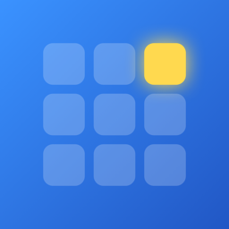
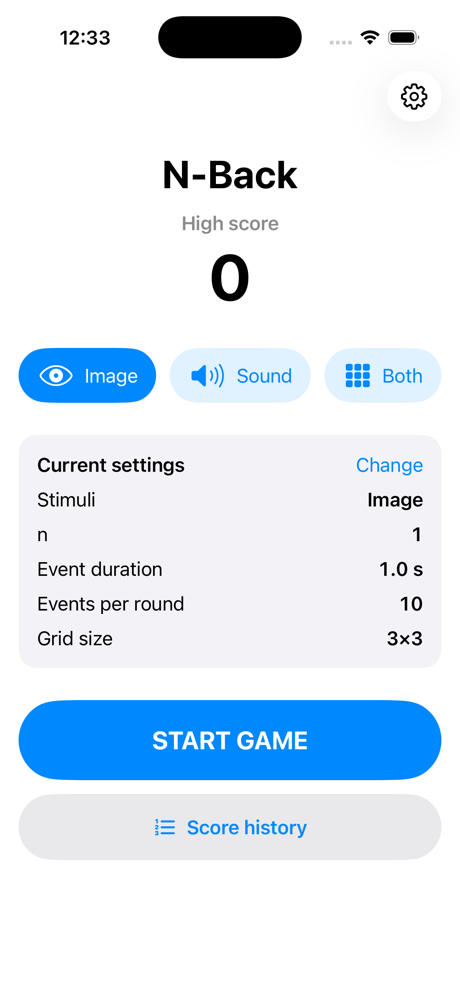
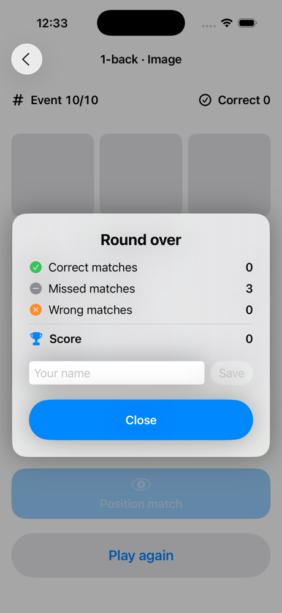
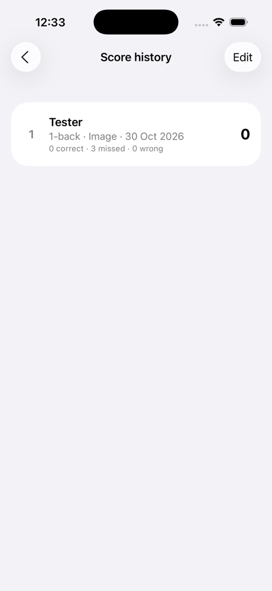

<p align="center">
  
</p>

<h1 align="center">N-Back</h1>

<p align="center">
  A working-memory game for iPhone and iPad, built in SwiftUI.<br>
  Lab B:1 · HI1033 / CM2023 · KTH
</p>

<p align="center">
  
  
  
  
  
</p>

<p align="center">
  
  &nbsp;
  
  &nbsp;
  
</p>

## How to play

Stimuli appear one at a time. Press **match** when the current one is the same as the one exactly **n** steps earlier.

Example with **n = 2** and spoken letters:

| Event | 1 | 2 | 3 | 4 | 5 | 6 |
|---|---|---|---|---|---|---|
| Letter | K | T | **K** | R | T | **R** |
| Press match? | – | – | ✅ same as event 1 | – | – | ✅ same as event 4 |

Choose what to train on the home screen:
- **Image**: one cell lights up in a 3×3 grid (up to 5×5).
- **Sound**: a letter is spoken (H, K, O, Q, R, S, T, Y, chosen so none sound alike).
- **Both**: dual n-back. Grid and letters at the same time, with one match button for each.

**Score = correct matches − wrong matches** (never below 0). The best score is saved as the high score.

## Features

| | |
|---|---|
| **Home screen** | High score, stimulus choice, current settings (n, event duration, events per round) |
| **Game screen** | Live event number and correct responses, a gentle shake and colour change on a wrong press |
| **Round summary** | Popup with correct, missed and wrong matches; save the round under your name |
| **Score history** | Every saved round in a local Core Data database, best first; swipe to delete |
| **Settings** | n, event duration, events per round, grid size, number of letters; kept between launches |
| **Layout** | Portrait and landscape, iPhone and iPad |
| **Accessibility** | Large match buttons (≥ 44 pt), VoiceOver labels, letters shown on screen if no voice is available |

### Game rules
- 20–40 % of the events that can match are matches, and the first *n* events never match.
  The skeleton's `nback.c` makes the raw sequence; both rules are enforced in Swift.
- A press is ignored before the round starts, after it ends, during the first *n* events, and if it is a second press on the same event.
- The round timer stops cleanly when the round ends or you leave the game screen.

## Run the app

You need **a Mac with Xcode 15 or later**. iOS apps cannot run in a web browser.

### 1. Get the project
**From this page:** click the green **`<> Code`** button → **Open with Xcode**.

**Or from the terminal:**
```bash
git clone https://github.com/siljekongstorpjohansen/N-Back-SwiftUI.git
open N-Back-SwiftUI/N-Back-SwiftUI.xcodeproj
```

### 2. Run it
- **Simulator:** pick an iPhone or iPad in the device menu at the top of Xcode and press **▶ Run** (⌘R).
- **Your own iPhone or iPad** (iOS 16.4+, a free Apple ID is enough):
  1. Xcode → **Settings → Accounts** → add your Apple ID.
  2. Select the **N-Back-SwiftUI** target → **Signing & Capabilities** → choose your **Team** and change the
     **Bundle Identifier** to something unique (e.g. `com.yourname.NBack`).
  3. Connect the device, turn on **Settings → Privacy & Security → Developer Mode**, select it in Xcode and press ⌘R.
  4. The first time, trust the developer on the device: **Settings → General → VPN & Device Management**.

  With a free Apple ID the app keeps working for 7 days; press Run again to renew it.

## Run the tests

In Xcode press **⌘U**, or:
```bash
xcodebuild test -scheme N-Back-SwiftUI -destination 'platform=iOS Simulator,name=iPhone 17'
```
Use any simulator you have installed. All 30 tests pass:

| Test class | Tests | What it checks |
|---|---|---|
| `NBackSequenceGeneratorTests` | 6 | Sequence length and values, 20–40 % matches, no match in the first n events |
| `NBackGameTests` | 15 | Ignored presses, one press per event, hits, misses, wrong presses, score formula |
| `GameSettingsTests` | 5 | Settings kept in range, distinct letters, settings and high score saved |
| `ScoreHistoryStoreTests` | 4 | Rounds saved, loaded, sorted and deleted; player names cleaned |

## Project structure (MVVM)

```
N-Back-SwiftUI/
├── N_Back_SwiftUIApp.swift        App entry, creates the ViewModel
├── N_Back_SwiftUIVM.swift         ViewModel: round timer, speech, published state
├── Model/
│   ├── N_Back_SwiftUIModel.swift  Settings, sequence rules, game state, scoring, storage
│   └── nback.c / nback.h          Skeleton's raw sequence generator (C)
└── View/
    └── Views.swift                Home, game, settings and score history screens
N-Back-SwiftUITests/
└── N_Back_SwiftUITests.swift      XCTest unit tests
```

Only Apple frameworks are used: SwiftUI, Foundation, AVFoundation, Core Data and XCTest.

More detail: [SPEC.md](SPEC.md) (requirements), [STYLE.md](STYLE.md) (architecture), [CONTEXT.md](CONTEXT.md) (course constraints).

## Credits

- Based on the course skeleton [JonasWillen/N-Back-SwiftUI](https://github.com/JonasWillen/N-Back-SwiftUI).
- Parts of this project were written with help from an AI assistant (Claude). Commits with AI help carry a
  `Co-Authored-By` line, as the course requires.
